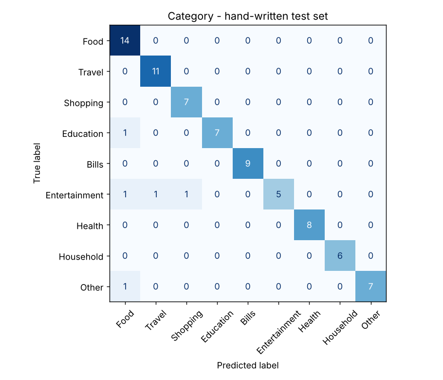
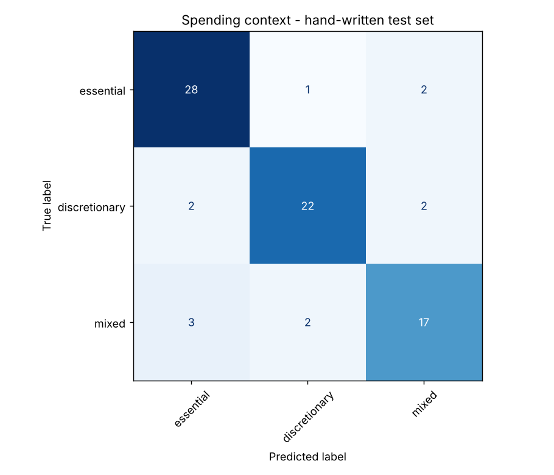

# ML evaluation report - Intelligent Transaction Understanding

Model: TF-IDF (word 1-2-grams + char 2-5-grams) -> Logistic Regression (two heads: category, spending context).

Training rows: **3804** (augmented from **317** seed phrases). Hand-written test rows: **79**.

> **Read this first.** All data is synthetic / hand-written by the project author. These numbers show the pipeline works and generalises to unseen phrasings; they do **not** prove accuracy on real users' descriptions.

## A. Grouped 5-fold cross-validation (phrase variants never split across folds)

Category:

| accuracy | macro_f1 | macro_precision | macro_recall |
|---|---|---|---|
| 0.5074 | 0.4875 | 0.4954 | 0.4904 |

Context:

| accuracy | macro_f1 | macro_precision | macro_recall |
|---|---|---|---|
| 0.5297 | 0.5236 | 0.5243 | 0.5234 |

Complement NB on the same folds - category: acc 0.5034, macro-F1 0.4833; context: acc 0.5373, macro-F1 0.5243.

**Why CV is much lower than the test set:** CV holds out whole seed phrases (e.g. every variant of 'mattress'), so many held-out phrases contain words never seen in training - a harsh, realistic 'new vocabulary' test. The hand-written test set was written by the same author and re-uses many everyday keywords, so it is the optimistic end. Real-world accuracy should be expected between the two.

## B. Independent hand-written test set

Category:

| accuracy | macro_f1 | macro_precision | macro_recall |
|---|---|---|---|
| 0.9367 | 0.9366 | 0.9572 | 0.9306 |

Context:

| accuracy | macro_f1 | macro_precision | macro_recall |
|---|---|---|---|
| 0.8481 | 0.8428 | 0.846 | 0.8407 |

Baselines (category, same test set):

| model | accuracy | macro-F1 |
|---|---|---|
| logistic regression (ours) | 0.9367 | 0.9366 |
| majority_class | 0.1772 | 0.0335 |
| tfidf_complement_nb | 0.9747 | 0.9765 |

Baselines (context, same test set):

| model | accuracy | macro-F1 |
|---|---|---|
| logistic regression (ours) | 0.8481 | 0.8428 |
| majority_class | 0.3924 | 0.1879 |
| tfidf_complement_nb | 0.8734 | 0.867 |

## Confidence vs. reality (category head)

If the confidence is meaningful, accuracy should rise with the band.

| band | CV n | CV accuracy | test n | test accuracy |
|---|---|---|---|---|
| low (<0.35) | 839 | 0.194 | 3 | 0.333 |
| medium | 1257 | 0.445 | 3 | 0.667 |
| high (>=0.60) | 1708 | 0.707 | 73 | 0.973 |

## Per-class report (test set, category)

```
               precision    recall  f1-score   support

         Food       0.82      1.00      0.90        14
       Travel       0.92      1.00      0.96        11
     Shopping       0.88      1.00      0.93         7
    Education       1.00      0.88      0.93         8
        Bills       1.00      1.00      1.00         9
Entertainment       1.00      0.62      0.77         8
       Health       1.00      1.00      1.00         8
    Household       1.00      1.00      1.00         6
        Other       1.00      0.88      0.93         8

     accuracy                           0.94        79
    macro avg       0.96      0.93      0.94        79
 weighted avg       0.95      0.94      0.93        79

```

## Test-set mistakes

| text | true cat | pred cat | true ctx | pred ctx | conf |
|---|---|---|---|---|---|
| Uber to the airport | Travel | Travel | mixed | discretionary | 0.98 |
| petrol for scooty | Travel | Travel | mixed | essential | 0.97 |
| auto se ghar gaya | Travel | Travel | mixed | essential | 0.41 |
| Cab to railway station at night | Travel | Travel | mixed | discretionary | 0.96 |
| Toll and fuel for road trip | Travel | Travel | discretionary | mixed | 0.99 |
| Bought a backpack for college | Shopping | Shopping | mixed | essential | 0.96 |
| Online shopping spree | Shopping | Shopping | discretionary | mixed | 0.97 |
| printed assignment at cyber cafe | Education | Food | essential | discretionary | 0.93 |
| WiFi router plan renewal | Bills | Bills | essential | mixed | 0.94 |
| Netflix monthly plan | Entertainment | Entertainment | discretionary | essential | 0.87 |
| watched a movie at inox | Entertainment | Food | discretionary | discretionary | 0.27 |
| bought skins in Free Fire | Entertainment | Shopping | discretionary | discretionary | 0.22 |
| College fest tickets | Entertainment | Travel | discretionary | essential | 0.68 |
| Laundry for the week | Other | Food | essential | essential | 0.59 |
| ATM charges | Other | Other | essential | mixed | 0.9 |





## Known limitations

- Synthetic / hand-written data; real descriptions (merchant codes, abbreviations, other languages) will be harder.
- 'Context' labels are the author's subjective view of typical need/want; the same purchase can be a need for one person and a want for another.
- Romanised Hinglish only; Devanagari script and other languages are not handled.
- Bag-of-words cannot understand negation or sarcasm and ignores amount, time and who paid.
- Next step with real data: collect the user's accepted/corrected suggestions (stored by the app) and retrain; compare against sentence-embedding features (e.g. multilingual MiniLM) before switching.